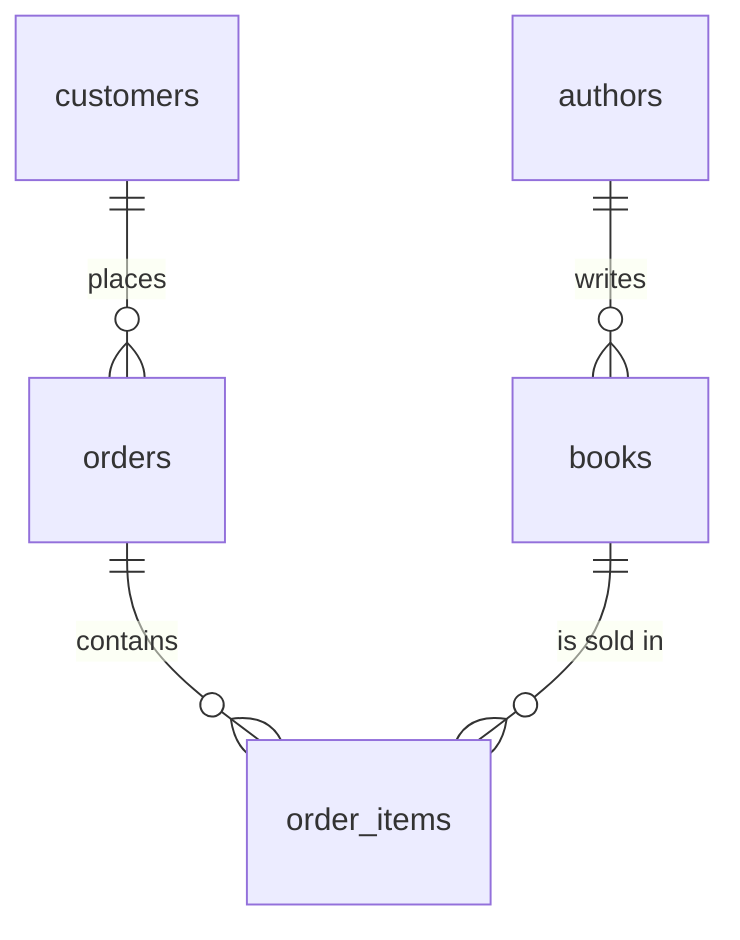

# Bookstore schema and queries

A small PostgreSQL 16 project: a normalized database for a bookstore, sample data, tests that prove the schema rejects bad data, and 20 SQL queries that answer business questions.

Built as a learning project covering schema design, primary and foreign keys, constraints, JOINs, GROUP BY and psql.

## What's in the repo

| File | What it does |
|---|---|
| `compose.yaml` | Runs PostgreSQL 16 in Docker |
| `sql/01_setup.sql` | Creates the `bookstore_app` role, the `bookstore` database and the `shop` schema |
| `sql/02_schema.sql` | Creates the five tables with their keys and constraints |
| `sql/03_data.sql` | Loads the sample data (`INSERT` for authors, customers and orders, `\copy` for the CSV files) |
| `data/books.csv`, `data/order_items.csv` | Sample data loaded with `\copy` |
| `sql/03_bad_data_tests.sql` | 16 statements that must each fail, one per rule |
| `sql/04_queries_1_10.sql` | Business questions 1–10 |
| `sql/05_queries_11_20.sql` | Business questions 11–20 |

## Schema



- **authors** (author_id, first_name, last_name, country)
- **books** (book_id, title, isbn, genre, price, published_year, stock, author_id)
- **customers** (customer_id, first_name, last_name, email, city, joined_on)
- **orders** (order_id, customer_id, order_date, shipped_date, status)
- **order_items** (order_id, book_id, quantity, unit_price), with primary key (order_id, book_id)

Rules the database enforces:

- `price` and `unit_price` are above 0, `stock` is 0 or more, `quantity` is above 0.
- An ISBN is exactly 13 digits and unique. An email is unique and has the shape `x@y.z`.
- `published_year` is between 1450 and 2100.
- `status` is one of `pending`, `shipped`, `delivered`, `cancelled`.
- `shipped_date` is never before `order_date`.
- Every book has an existing author, and every order has an existing customer.
- Deleting an order deletes its lines. A book that has been sold, or an author who has books, can't be deleted.

`order_items.unit_price` stores the price paid on the day of the sale, so old orders keep their amounts when a book's price changes.

## Run it

You need Docker Desktop.

```powershell
docker compose up -d
docker compose exec db psql -U postgres -v ON_ERROR_STOP=1 -f /sql/01_setup.sql
docker compose exec db psql -U bookstore_app -d bookstore -v ON_ERROR_STOP=1 -f /sql/02_schema.sql
docker compose exec db psql -U bookstore_app -d bookstore -v ON_ERROR_STOP=1 -f /sql/03_data.sql
```

The last command ends by printing the row counts: 9 authors, 21 books, 12 customers, 25 orders and 38 order items.

Run the constraint tests. Every test must print an `ERROR` that names its rule, and the counts at the end must not change:

```powershell
docker compose exec db psql -U bookstore_app -d bookstore -f /sql/03_bad_data_tests.sql
```

Run the queries:

```powershell
docker compose exec db psql -U bookstore_app -d bookstore -f /sql/04_queries_1_10.sql
docker compose exec db psql -U bookstore_app -d bookstore -f /sql/05_queries_11_20.sql
```

The server listens on `127.0.0.1:5433`. The passwords in `compose.yaml` and `01_setup.sql` are practice passwords for a server that only your own computer can reach.

## Conventions

- **Sold** means an order with status `shipped` or `delivered`. Pending and cancelled orders don't count as revenue.
- **Fixed date:** the sample data ends on 2026-10-28. The date questions in `05_queries_11_20.sql` use `\set as_of '2026-10-28'`, so their answers don't change over time. `:'as_of'` only works in psql. In another client, write `DATE '2026-10-28'` or `current_date` instead.

## The 20 business questions

| # | Question | SQL used | Answer with the sample data |
|---|---|---|---|
| 1 | What does the store sell, from most to least expensive? | `SELECT`, `ORDER BY` | 21 books, from 1Q84 (24.50) to Animal Farm (7.50) |
| 2 | Which books are running low (fewer than 5 copies)? | `WHERE` | 7 books, Emma (0 copies) first |
| 3 | Which customers in Lagos or Douala joined during 2025? | `IN`, `AND`, date range | Aïcha, Chidi, Fatima, Emeka |
| 4 | Who wrote each book? | `INNER JOIN` | 21 books with their authors |
| 5 | What did Chidi Okafor buy, and what did each line cost? | 4-table `JOIN`, calculated column | 8 lines across 4 orders |
| 6 | Which authors have no books in the store yet? | `LEFT JOIN`, `IS NULL` | Toni Morrison |
| 7 | How many titles does each genre have, and at what average price? | `GROUP BY`, `count`, `avg` | 5 genres. Literary Fiction has the most titles (7) |
| 8 | How much revenue has each genre brought in? | `SUM` over joined tables | Classic 166.45 … Essay 31.96 |
| 9 | Which customers have spent more than 50 in total? | `HAVING`, `count(DISTINCT)` | Chidi 161.14, Aïcha 92.34, Samuel 68.47, Emeka 60.86 |
| 10 | What are the 5 best-selling books by copies sold? | `ORDER BY`, `LIMIT` | Nineteen Eighty-Four (7) first |
| 11 | Which books cost more than the average book? | Subquery returning one value | 9 books above 13.10 |
| 12 | Which books have never been ordered? | `NOT IN` subquery | Arrow of God, Harmattan Letters, Homage to Catalonia |
| 13 | Which customers bought at least one book by a Nigerian author? | `IN` subquery | Aïcha, Chidi, Emeka, Samuel, Sophie |
| 14 | Which customers have never placed an order? | `NOT EXISTS` | Thomas Wright, Brigitte Ateba |
| 15 | Which customers placed an order in the last 30 days? | `EXISTS`, date minus days | Aïcha, Grace, Jean-Paul, Samuel |
| 16 | How many titles are out of stock, low, or well stocked? | `CASE` in `GROUP BY` | 1 out of stock, 6 low, 14 ok |
| 17 | Which loyalty tier is each customer in? | `CASE`, `LEFT JOIN`, `coalesce` | 1 gold, 4 silver, 5 bronze, 2 new |
| 18 | How many days does shipping take, per year? | Date − date, `extract` | 2025: 3.1 days on average. 2026: 2.6 |
| 19 | Which orders are still open, and how old are they? | Date arithmetic | Orders 22, 23, 24, 25 (16, 8, 3 and 1 days old) |
| 20 | How much revenue did each month of 2026 bring in? | `to_char`, `GROUP BY` month | 9 months. April has no sales |

## Queries

### Q1. What does the store sell, from most to least expensive?

```sql
SELECT title, genre, price
FROM books
ORDER BY price DESC, title;
```

### Q2. Which books are running low (fewer than 5 copies), most urgent first?

```sql
SELECT title, stock, price
FROM books
WHERE stock < 5
ORDER BY stock, title;
```

### Q3. Which customers in Lagos or Douala joined during 2025?

```sql
SELECT first_name, last_name, city, joined_on
FROM customers
WHERE city IN ('Lagos', 'Douala')
  AND joined_on >= '2025-01-01'
  AND joined_on <  '2026-01-01'
ORDER BY joined_on;
```

### Q4. Who wrote each book?

```sql
SELECT a.first_name || ' ' || a.last_name AS author,
       b.title,
       b.published_year
FROM books AS b
JOIN authors AS a ON a.author_id = b.author_id
ORDER BY a.last_name, b.published_year;
```

### Q5. What did Chidi Okafor buy, and what did each line cost?

```sql
SELECT o.order_id,
       o.order_date,
       b.title,
       oi.quantity,
       oi.unit_price,
       oi.quantity * oi.unit_price AS line_total
FROM customers AS c
JOIN orders      AS o  ON o.customer_id = c.customer_id
JOIN order_items AS oi ON oi.order_id   = o.order_id
JOIN books       AS b  ON b.book_id     = oi.book_id
WHERE c.email = 'chidi.okafor@example.com'
ORDER BY o.order_date, b.title;
```

### Q6. Which authors have no books in the store yet?

```sql
SELECT a.first_name || ' ' || a.last_name AS author,
       a.country
FROM authors AS a
LEFT JOIN books AS b ON b.author_id = a.author_id
WHERE b.book_id IS NULL
ORDER BY author;
```

### Q7. How many titles does each genre have, and at what average price?

```sql
SELECT genre,
       count(*)             AS titles,
       round(avg(price), 2) AS avg_price
FROM books
GROUP BY genre
ORDER BY titles DESC, genre;
```

### Q8. How much revenue has each genre brought in?

```sql
SELECT b.genre,
       sum(oi.quantity * oi.unit_price) AS revenue
FROM order_items AS oi
JOIN orders AS o ON o.order_id = oi.order_id
JOIN books  AS b ON b.book_id  = oi.book_id
WHERE o.status IN ('shipped', 'delivered')
GROUP BY b.genre
ORDER BY revenue DESC;
```

### Q9. Which customers have spent more than 50 in total?

```sql
SELECT c.first_name || ' ' || c.last_name AS customer,
       count(DISTINCT o.order_id)          AS orders,
       sum(oi.quantity * oi.unit_price)    AS total_spent
FROM customers AS c
JOIN orders      AS o  ON o.customer_id = c.customer_id
JOIN order_items AS oi ON oi.order_id   = o.order_id
WHERE o.status IN ('shipped', 'delivered')
GROUP BY c.customer_id, c.first_name, c.last_name
HAVING sum(oi.quantity * oi.unit_price) > 50
ORDER BY total_spent DESC;
```

### Q10. What are the 5 best-selling books by copies sold?

```sql
SELECT b.title,
       sum(oi.quantity) AS copies_sold
FROM order_items AS oi
JOIN orders AS o ON o.order_id = oi.order_id
JOIN books  AS b ON b.book_id  = oi.book_id
WHERE o.status IN ('shipped', 'delivered')
GROUP BY b.book_id, b.title
ORDER BY copies_sold DESC, b.title
LIMIT 5;
```

### Q11. Which books cost more than the average book?

```sql
SELECT title, price
FROM books
WHERE price > (SELECT avg(price) FROM books)
ORDER BY price DESC;
```

### Q12. Which books have never been ordered?

```sql
SELECT title, stock
FROM books
WHERE book_id NOT IN (SELECT book_id FROM order_items)
ORDER BY title;
```

### Q13. Which customers bought at least one book by a Nigerian author?

```sql
SELECT first_name || ' ' || last_name AS customer, city
FROM customers
WHERE customer_id IN (
    SELECT o.customer_id
    FROM orders AS o
    JOIN order_items AS oi ON oi.order_id = o.order_id
    JOIN books       AS b  ON b.book_id   = oi.book_id
    JOIN authors     AS a  ON a.author_id = b.author_id
    WHERE a.country = 'Nigeria'
      AND o.status IN ('shipped', 'delivered')
)
ORDER BY customer;
```

### Q14. Which customers have never placed an order?

```sql
SELECT first_name || ' ' || last_name AS customer, email, joined_on
FROM customers AS c
WHERE NOT EXISTS (
    SELECT 1 FROM orders AS o WHERE o.customer_id = c.customer_id
)
ORDER BY joined_on;
```

### Q15. Which customers placed an order in the last 30 days?

```sql
SELECT first_name || ' ' || last_name AS customer, city
FROM customers AS c
WHERE EXISTS (
    SELECT 1
    FROM orders AS o
    WHERE o.customer_id = c.customer_id
      AND o.order_date > :'as_of'::date - 30
)
ORDER BY customer;
```

### Q16. How many titles are out of stock, low, or well stocked?

```sql
SELECT CASE
           WHEN stock = 0 THEN 'out of stock'
           WHEN stock < 5 THEN 'low (1-4)'
           ELSE 'ok (5+)'
       END AS stock_level,
       count(*) AS titles
FROM books
GROUP BY stock_level
ORDER BY min(stock);
```

### Q17. Which loyalty tier is each customer in, based on total spent?

```sql
SELECT c.first_name || ' ' || c.last_name AS customer,
       coalesce(sum(oi.quantity * oi.unit_price), 0) AS total_spent,
       CASE
           WHEN sum(oi.quantity * oi.unit_price) >= 100 THEN 'gold'
           WHEN sum(oi.quantity * oi.unit_price) >= 40  THEN 'silver'
           WHEN sum(oi.quantity * oi.unit_price) >  0   THEN 'bronze'
           ELSE 'new'
       END AS tier
FROM customers AS c
LEFT JOIN orders AS o
       ON o.customer_id = c.customer_id
      AND o.status IN ('shipped', 'delivered')
LEFT JOIN order_items AS oi ON oi.order_id = o.order_id
GROUP BY c.customer_id, c.first_name, c.last_name
ORDER BY total_spent DESC, customer;
```

### Q18. How many days does shipping take, per year?

```sql
SELECT extract(year FROM order_date)            AS year,
       count(*)                                 AS shipped_orders,
       round(avg(shipped_date - order_date), 1) AS avg_days,
       max(shipped_date - order_date)           AS slowest_days
FROM orders
WHERE shipped_date IS NOT NULL
GROUP BY year
ORDER BY year;
```

### Q19. Which orders are still open, and how many days old are they?

```sql
SELECT o.order_id,
       c.first_name || ' ' || c.last_name AS customer,
       o.status,
       o.order_date,
       :'as_of'::date - o.order_date AS days_old
FROM orders AS o
JOIN customers AS c ON c.customer_id = o.customer_id
WHERE o.status IN ('pending', 'shipped')
ORDER BY days_old DESC;
```

### Q20. How much revenue did each month of 2026 bring in?

```sql
SELECT to_char(o.order_date, 'YYYY-MM')  AS month,
       count(DISTINCT o.order_id)        AS orders,
       sum(oi.quantity * oi.unit_price)  AS revenue
FROM orders AS o
JOIN order_items AS oi ON oi.order_id = o.order_id
WHERE o.status IN ('shipped', 'delivered')
  AND o.order_date >= '2026-01-01'
  AND o.order_date <  '2027-01-01'
GROUP BY month
ORDER BY month;
```

The queries above are copied from `sql/04_queries_1_10.sql` and `sql/05_queries_11_20.sql`. If they ever differ, the `.sql` files are the source of truth.
